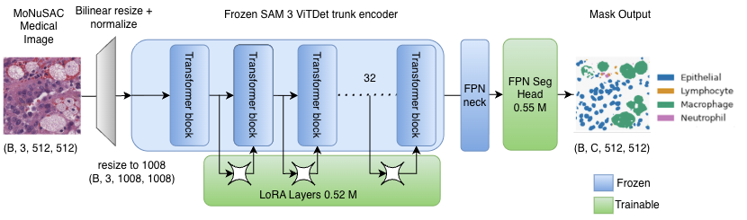
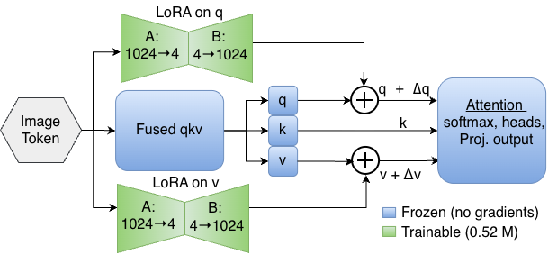
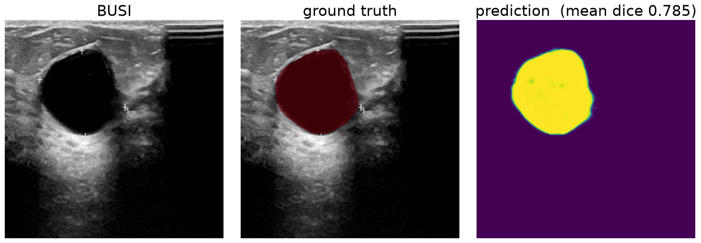
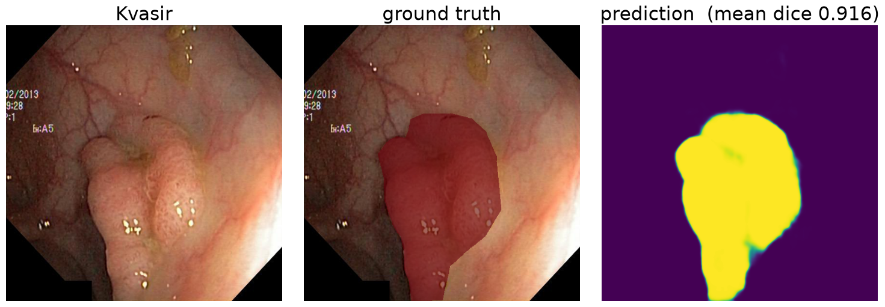
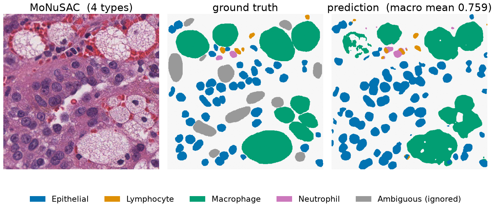

# Foundation Encoder vs. Specialist Network in Medical Segmentation

**Is adapting a large segmentation foundation model worth the cost on medical images, or is a small purpose-built network enough?**

We strip Meta's **SAM 3** down to its image encoder, attach a lightweight segmentation head, and adapt it two ways: **full fine-tuning** and **LoRA**. Both are compared against a tuned **U-Net** under one controlled pipeline on three MedSegBench datasets.

Georgia Tech CS 7643 (Deep Learning), Summer 2026 · PyTorch · trained on a single NVIDIA H100 (PACE-ICE)

## Key findings

- **LoRA is the only SAM 3 variant that beats the U-Net on all three datasets**, while training **425× fewer parameters** than full fine-tuning (1.07M vs. 455.1M).
- **On binary tasks the foundation encoder roughly matches the U-Net** (+0.005 Dice on BUSI, +0.019 on Kvasir-SEG), so the extra cost buys little there.
- **On multiclass histopathology it gains +0.114 Dice** (MoNuSAC). That dataset is also the smallest and the only pathology task, so we do not attribute the gain to any single factor.
- **LoRA beats full fine-tuning on both binary tasks**; full fine-tuning wins on MoNuSAC.

## Architecture



- **Backbone:** SAM 3's 32-block ViTDet image encoder and SimpleFPN neck. The text encoder, detector, tracker and prompting components are removed, since the task has a fixed label set and no prompts.
- **Head:** a small FPN segmentation head (0.55M parameters) that replaces SAM 3's prompt-conditioned mask decoder.
- **LoRA:** SAM 3 fuses the query, key and value projections into a single `Linear(1024, 3072)`, so standard LoRA wrappers do not apply. We wrote a **fused-qkv LoRA adapter** that injects rank-4 updates into the query and value slices of all 32 blocks (0.52M parameters, 0.24% of the encoder).
- **Trainability fix:** SAM 3's released MLP calls an inference-only fused operator that raises when gradients are enabled. We patched it with a differentiable equivalent so the trunk can be fine-tuned at all.

<p align="center"></p>

## Results

Test-set performance. Dice is the primary metric; NSD (normalized surface distance, 2 px tolerance) measures boundary accuracy. MoNuSAC scores average over the nucleus classes present in each image.

| Method | Trainable params | BUSI Dice | Kvasir-SEG Dice | MoNuSAC Dice | BUSI NSD | Kvasir-SEG NSD | MoNuSAC NSD |
|---|---|---|---|---|---|---|---|
| U-Net (MiT-B0, ImageNet) | 5.55M | 0.780 | 0.897 | 0.678 | **0.407** | 0.622 | 0.566 |
| **SAM 3 + LoRA (r=4)** | **1.07M** | **0.785** | **0.916** | 0.759 | 0.401 | 0.659 | 0.634 |
| SAM 3, full fine-tune | 455.1M | 0.754 | 0.900 | **0.792** | 0.406 | **0.670** | **0.714** |

The U-Net reference is deliberately strong: a 48-run factorial (4 encoders × ImageNet init × augmentation) whose best configuration beats the published MedSegBench baselines by 0.069 to 0.119 F1.

### LoRA sensitivity (BUSI, validation Dice)

| Rank | Params | Dice | | Learning rate | Dice |
|---|---|---|---|---|---|
| 2 | 0.80M | 0.773 | | 3e-5 | 0.765 |
| 4 | 1.07M | 0.782 | | 1e-4 | 0.782 |
| 8 | 1.59M | 0.786 | | 3e-4 | 0.782 |
| 16 | 2.64M | 0.798 | | 1e-3 | 0.784 |

Dice still rises at rank 16, so the reported rank-4 results are a lower bound rather than a tuned best. Learning rate matters only at the low end.

### Qualitative results (LoRA)





## Datasets

All three come from [MedSegBench](https://github.com/zekikus/MedSegBench) at 512×512 with the official splits. Every configuration choice was made on validation, and the test split was scored once.

| Dataset | Modality | Target | Classes | Train / Val / Test |
|---|---|---|---|---|
| BUSI | Breast ultrasound (grayscale) | Lesion | 2 | 452 / 64 / 131 |
| Kvasir-SEG | Endoscopy (RGB) | Polyp | 2 | 700 / 100 / 200 |
| MoNuSAC | Histopathology (RGB) | Nuclei | 6 | 188 / 21 / 101 |

## Limitations

- **No repeated seeds.** Run-to-run variation is about 0.01 Dice, so the binary-task gains over the U-Net (0.005 and 0.019) sit close to noise.
- **Confounded MoNuSAC result.** It is simultaneously the only multiclass, only pathology, smallest-object and smallest dataset.
- **Noisy model selection on MoNuSAC.** With only 21 validation images, validation and test rankings sometimes disagreed.
- **Boundary detail.** The head predicts at stride 4 and upsamples, so structure finer than 4 px is lost before the mask is produced.

## Repository structure

```
src/medseg/
  models/      sam3_backbone.py, sam3_medseg.py, lora.py, seg_head.py, unet.py
  engine/      trainer.py, losses.py, metrics.py, experiment.py
  data/        medseg_data.py, transforms.py
configs/
  data/        busi.yaml, kvasir.yaml, monusac.yaml
  experiment/  U-Net sweeps, SAM 3 full fine-tuning, lora/{baseline, hp, smoke}
scripts/       train_lora.py, train_unet.py, eval_lora.py, evaluate_full.py, slurm/
results/       metrics CSVs and prediction figures
docs/          sam.md (SAM 3 setup), lora.md, cluster.md (PACE-ICE guide), figures/
tests/         unit tests for LoRA, the head, losses and metrics
```

## Getting started

SAM 3 weights are gated on Hugging Face: request access at [huggingface.co/facebook/sam3](https://huggingface.co/facebook/sam3) first. See [`docs/sam.md`](docs/sam.md) for setup details.

```bash
# environment
conda env create -f environment.yml
conda activate sam-medseg
git clone https://github.com/facebookresearch/sam3.git && pip install -e sam3
hf auth login

# quick smoke test (8 images, 2 epochs)
python scripts/train_lora.py configs/experiment/lora/smoke/sam3_lora_busi.yaml

# full LoRA run on BUSI (the config's finetune_mode selects LoRA or full fine-tuning)
python scripts/train_lora.py configs/experiment/lora/baseline/sam3_lora_busi_full.yaml

# evaluate the LoRA checkpoints
python scripts/eval_lora.py

# run the tests
pytest tests/
```

To run on the PACE-ICE cluster with SLURM, see [`docs/cluster.md`](docs/cluster.md).

## Team

| Member | Contribution |
|---|---|
| Nikhil Sulay | LoRA adaptation arm, including the fused-qkv adapter for SAM 3's merged projection; rank, learning-rate and batch sweeps; architecture and results figures; report |
| Renzo Silvera | Dataset ingestion and augmentation pipeline; U-Net factorial across all three datasets; shared evaluation script; report |
| Shin Koo Kang | SAM 3 full fine-tuning pipeline across BUSI, Kvasir-SEG and MoNuSAC; report |
| Razeen Basunia | YOLO implementation (omitted from the final report for length and focus) |

## References

- Carion et al., *SAM 3: Segment Anything with Concepts*, arXiv:2511.16719, 2025
- Hu et al., *LoRA: Low-Rank Adaptation of Large Language Models*, 2021
- Kuş and Aydin, *MedSegBench: A Comprehensive Benchmark for Medical Image Segmentation in Diverse Data Modalities*, Scientific Data, 2024
- Ronneberger et al., *U-Net: Convolutional Networks for Biomedical Image Segmentation*, MICCAI 2015
