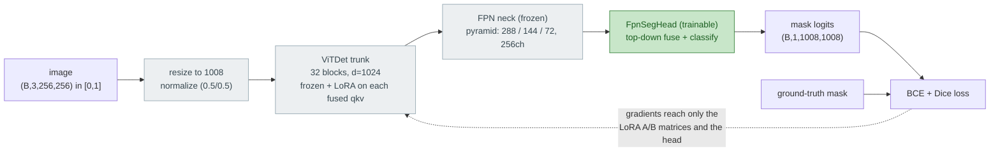

# LoRA adaptation of SAM 3

How we adapt the frozen SAM 3 vision backbone into a medical segmenter by
training a tiny set of low-rank adapters (plus the shared seg head) instead of
the full network.

---

## 1. The idea: adapt a big model by training a small update

Fine-tuning normally means updating a weight matrix `W` with a full-size update
`dW` of the same shape. For SAM 3's attention projections that is `1024 x 1024`
numbers per projection per layer, and a whole new copy of the backbone per task.

**LoRA** (Low-Rank Adaptation) bets that the update you actually need is
low-rank: `dW` can be well approximated by the product of two skinny matrices:

```
dW ~ B * A      where  A is (r x d),  B is (d x r),  r << d
```

So instead of `d^2` numbers you train `2*r*d`. The layer's forward pass becomes:

```
y = W*x  +  (B*A)*x * (alpha / r)
    -----    ------------------
    frozen    trainable LoRA update
```

Two properties make this work and are worth knowing:

- **`W` is frozen.** The pretrained weights are never touched. Only `A` and `B`
  get gradients; that is the parameter efficiency.
- **`B` is initialized to zero, `A` to random.** At step 0, `B*A = 0`, so the
  adapted model is identical to the pretrained one. Training gently moves away
  from it rather than jolting the foundation model with a random perturbation.
  (Zeroing both would kill gradient flow and the adapter would never learn, so
  only `B`.)

We never form the `d x d` matrix `B*A`. We apply it through the rank-`r`
bottleneck: `B(A(x))` goes `d -> r -> d`, which is also why it is cheap at
compute time, not just storage time.

## 2. Where LoRA goes in SAM 3

The team model keeps only SAM 3's **vision path**: a ViTDet-style ViT trunk
(32 blocks, d = 1024, windowed attention over a spatial grid) followed by an
FPN neck that produces a 3-level feature pyramid. The language encoder and the
DETR detection machinery of full SAM 3 are unused in this project (our datasets
are single-concept, so promptable detection buys nothing; see section 7).

Each trunk block computes query/key/value with a single fused linear:

```python
self.qkv = nn.Linear(1024, 3072)     # output = [ Q | K | V ] concatenated
```

Following the SAMed recipe (and the LoRA paper's ablation), we inject adapters
into the **Q and V** projections only, leaving **K** untouched. Q and V are the
non-redundant levers: Q shifts where attention looks, V shifts what it
aggregates; K is largely reachable through Q via the `QK^T` product.

The `LoRA_qkv` wrapper runs the frozen `qkv`, then adds the LoRA deltas onto
the Q and V slices of its output:

```
qkv(x)  ->  [   Q    |   K    |   V    ]        (shape (..., 3*1024))
                +dq       +0       +dv
             --- LoRA ---        -- LoRA --
```

Because the wrapper's output has the exact same shape as the original `qkv`,
it is a drop-in replacement; the rest of the attention code runs unchanged.
One vitdet-specific detail: the trunk keeps tokens as a 4D `(B, H, W, C)` grid
rather than a flattened `(B, tokens, C)` sequence, so the wrapper slices with
`[..., :dim]` ellipsis indexing, which works for any leading shape. The slice
isolation (Q and V move, K bit-identical) is unit-tested.

## 3. The team architecture and where the trainable parts sit

All arms share one model, `Sam3MedSeg(finetune_mode=...)`, so the comparison
is apples to apples: same backbone, same head, the arms differ only in what is
trainable inside the backbone.



- **No prompts.** The old promptable-segmentation designs (boxes, then text)
  are gone with the mask decoder and DETR. The head always answers one fixed
  question per dataset: where is the polyp (Kvasir) / lesion (BUSI).
- The **ground-truth mask is used only in the loss**; nothing derived from it
  enters the model.
- **The seg head trains in every arm** (it is new and has no pretrained
  weights). The LoRA arm's trainable set is therefore adapters + head.
- Training runs in fp32: bf16 autocast crashes the backward pass on the
  cluster's torch/CUDA build, and casting the backbone to bf16 corrupts
  SAM 3's position embeddings. The backbone wrapper also patches an
  inference-only fused MLP op in vitdet that otherwise blocks gradients:
  relevant to any arm that backpropagates through the backbone, ours included.

## 4. Parameter efficiency (r = 4, verified 2026-07-20)

```
Sam3MedSeg(finetune_mode="lora"):
1,066,113 / 455,105,921 trainable  (0.2343%)
  =   524,288 LoRA adapters   (32 blocks x 2 adapters x 2*4*1024)
  +   541,825 FpnSegHead      (trained in every arm)
```

The adapter count derives directly from the architecture:

```
524,288 = 32 blocks x 2 adapters (Q, V) x (2 * r * d)
        = 32 x 2 x (2 * 4 * 1024)
        = 32 x 2 x 8,192
```

Compared to the full fine-tuning arm, which updates all 455.1M params of the
same model, the LoRA arm trains about **427x fewer** parameters. Counting only
what LoRA adds inside the backbone, the adapters are **0.12%** of the frozen
454.5M-param vision path. Checkpoint consequences: the learned state of this
arm is ~2 MB of adapters plus ~2 MB of head, against ~1.8 GB for a full
backbone copy, with the frozen base shared across tasks.

(The full `Sam3Image` release is 840.5M params; the 455.1M above is the vision
path our task model keeps. Quote percentages against 455.1M, the model that
actually trains and runs.)

## 5. Code map

| Piece | File | What it is |
|---|---|---|
| `LoRALayer` | `src/medseg/models/lora.py` | Low-rank adapter for one projection: `B(A(x))*(alpha/r)`, B zero-init |
| `LoRA_qkv` | `src/medseg/models/lora.py` | Wraps a fused qkv Linear; adds LoRA to the Q and V slices, K untouched |
| `LinearWithLoRA` | `src/medseg/models/lora.py` | Generic wrapper for a single (non-fused) Linear; used by the earlier HF-transformers port, kept as the general-purpose variant |
| `inject_lora_into_sam3` | `src/medseg/models/lora.py` | HF-transformers edition of the injection (separate q_proj/v_proj); superseded by the `Sam3MedSeg` path below |
| `"lora"` mode | `src/medseg/models/sam3_medseg.py` | The live injection: freeze backbone, wrap all 32 `blocks[i].attn.qkv`, head stays trainable |
| Tests | `tests/test_lora.py` | shape / zero-at-init / param-count / wrapper-equality / slice-isolation (incl. 4D input) |
| Demo | `notebooks/02_lora.ipynb` | Builds the model, shows the injection targets and the counts above |

Hyperparameters: rank `r = 4`, scaling `alpha = 4`, trunk width `d = 1024`.
Currently hardcoded in the `"lora"` branch; moving them (plus the target set)
into a model config is on the list, so the {q,v} vs {q,k,v,o} ablation is a
config change.

Ordering rule worth remembering when reading the injection code: **freeze
before wrap**. The freeze loop iterates the parameters that exist at that
moment; wrapping afterwards means the freshly created adapters are born
trainable and untouched by the freeze. Wrapping first would sweep the adapters
into the freeze and silently produce a decoder-only model. The tripwire for
any such mistake (including running the injection twice) is the trainable
count: anything other than 1,066,113 means the injection state is wrong.

## 6. Status

- [x] `LoRALayer`, `LinearWithLoRA`, `LoRA_qkv` + unit tests (5 passing)
- [x] Injection into the team model: `Sam3MedSeg(finetune_mode="lora")`,
      counts verified on the real gated weights (numbers above)
- [ ] Training harness wiring: experiment config for the LoRA arm, smoke run,
      then full runs on the cluster
- [ ] Adapter-only save/load (small checkpoint files)
- [ ] Model config (`lora_r`, `lora_alpha`, target set, weight revision pin)
- [ ] Ablations: rank sweep; {q,v} vs {q,k,v,o}

## 7. History (git has the details)

The design went through three phases; the earlier two are preserved in git
history and are part of the project's "what changed and why" narrative:

1. **SAM 1 prototype** (`segment-anything`, ViT-B, box prompts):
   147,456 / 93.7M trainable (0.157%, 635x reduction). Proved the mechanism;
   superseded when the team standardized on SAM 3.
2. **SAM 3 via HF `transformers`** (separate q_proj/v_proj, planned text
   prompts): 524,288 / 840.4M (0.062%) verified on the real gated weights.
   Superseded when the team standardized on the native `sam3` package with an
   image-only architecture and a trained FPN head, which removed text
   prompting (and its main risk: unproven zero-shot text prompting on medical
   concepts) entirely.
3. **Current**: native stack, fused qkv, `LoRA_qkv`, shared `Sam3MedSeg`.

## References

- Hu et al., *LoRA: Low-Rank Adaptation of Large Language Models*, 2021.
- Zhang & Liu, *Customized Segment Anything Model for Medical Image
  Segmentation* (SAMed), 2023.
- Kirillov et al., *Segment Anything*, 2023 (SAM 1).
- SAM 3 release: `github.com/facebookresearch/sam3` /
  `huggingface.co/facebook/sam3`.
- Li et al., *Exploring Plain Vision Transformer Backbones for Object
  Detection* (ViTDet), 2022.
- Lin et al., *Feature Pyramid Networks for Object Detection* (FPN), 2017.
- Ma et al., *Segment Anything in Medical Images* (MedSAM), Nature Comms,
  2024 (loss recipe).
