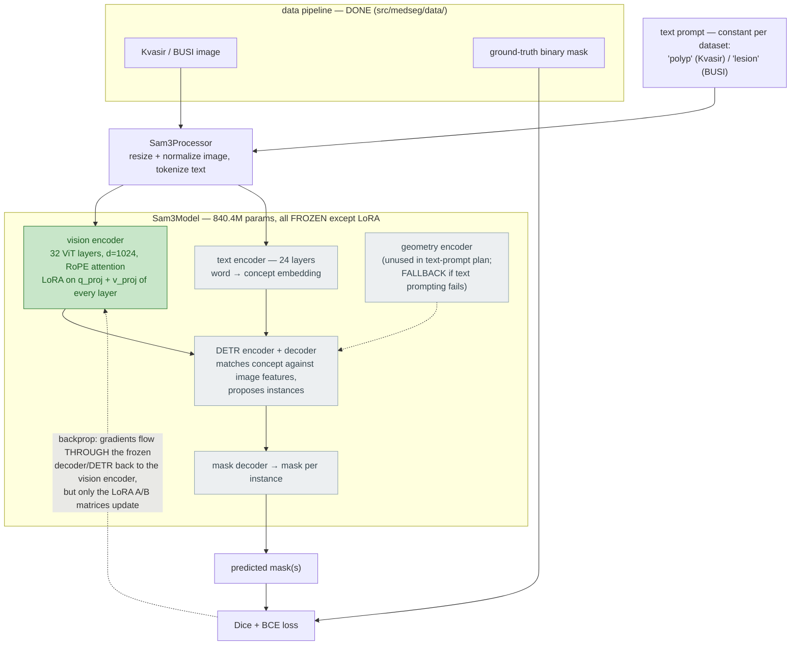

# LoRA adaptation of SAM

How we adapt the frozen Segment Anything Model (SAM) into a medical segmenter by
training a tiny set of low-rank adapters instead of the full network.

---

## 1. The idea: adapt a big model by training a small update

Fine-tuning normally means updating a weight matrix `W` with a full-size update
`ΔW` of the same shape — for SAM's attention projections that's `768 × 768 ≈ 590K`
numbers *per layer*, and a whole new copy of the encoder per task.

**LoRA** (Low-Rank Adaptation) bets that the *update* you actually need is
low-rank — that `ΔW` can be well-approximated by the product of two skinny
matrices:

```
ΔW ≈ B · A      where  A is (r × d),  B is (d × r),  r ≪ d
```

So instead of `d²` numbers you train `2·r·d`. The layer's forward pass becomes:

```
y = W·x  +  (B·A)·x · (α / r)
    └────┘   └──────────────┘
   frozen      trainable LoRA update
```

Two properties make this work and are worth knowing:

- **`W` is frozen.** SAM's pretrained weights are never touched. Only `A` and `B`
  get gradients — that is the parameter efficiency.
- **`B` is initialized to zero, `A` to random.** At step 0, `B·A = 0`, so the
  adapted model is *identical* to pretrained SAM. Training gently moves away from
  it rather than jolting the foundation model with a random perturbation. (Zeroing
  *both* would kill gradient flow and the adapter would never learn — so only `B`.)

We never form the `d × d` matrix `B·A`. We apply it through the rank-`r`
bottleneck: `B(A(x))` goes `d → r → d`, which is also why it is cheap at compute
time, not just storage time.

## 2. Where LoRA goes in SAM

SAM's image encoder is a Vision Transformer — a stack of 12 attention blocks. Each
block computes query/key/value with a single fused linear:

```python
self.qkv = nn.Linear(dim, dim * 3)     # output = [ Q | K | V ] concatenated
```

Following the SAMed recipe (and the original LoRA paper's ablation), we inject
adapters into the **Q and V** projections only, leaving **K** untouched — Q and V
are the non-redundant levers (Q shifts *where* attention looks, V shifts *what* it
aggregates; K is largely reachable through Q via the `QKᵀ` product).

The wrapper runs the frozen `qkv`, then adds the LoRA deltas onto the Q and V
slices of its output:

```
qkv(x)  →  [   Q    |   K    |   V    ]        (shape (..., 3·dim))
                +Δq      +0       +Δv
            └── LoRA ──┘        └─ LoRA ─┘
```

Because the wrapper's output has the exact same shape as the original `qkv`, it is
a drop-in replacement — the rest of SAM's attention code runs unchanged.

## 3. Parameter efficiency (SAM ViT-B, r = 4)

```
Before LoRA:  93,735,472 / 93,735,472 trainable  (100.00%)
After  LoRA:     147,456 / 93,882,928 trainable  (  0.157%)
```

**LoRA trains ~147K params instead of ~94M — a ~635× reduction.** The trainable
count derives directly from the architecture:

```
147,456 = 12 blocks × 2 adapters (Q, V) × (2 · r · d)
        = 12 × 2 × (2 · 4 · 768)
        = 12 × 2 × 6,144
```

Practical consequences: far less memory, faster training, and adapter checkpoints
of ~600 KB instead of a 375 MB model — with the frozen SAM shared across tasks.

## 4. How it trains — the box-prompt loop

SAM is **promptable**: it does not segment "the foreground" in the abstract, it
segments the object indicated by a *prompt* (here, a bounding box). Our data gives
`(image, ground-truth mask)` pairs but no prompts, so at training time we
manufacture the box from the ground-truth mask (with small random jitter, following
MedSAM, so the model tolerates imperfect human-drawn boxes).

The box says *where* the object is; SAM must still predict the exact per-pixel
boundary — which is 99% of the difficulty the box does not give away.

```
image ──► [SAM image encoder]──────────┐
  │            (frozen + LoRA)          ▼
  │                              image features
ground-truth mask                       │
  │                                     ▼
  └─► mask_to_box ──► box ─► [prompt encoder] ─► [mask decoder] ─► predicted mask
        (box prompt)          (frozen)            (frozen/tuned)         │
                                                                        ▼
                          ground-truth mask ──────► [Dice + BCE loss] ◄──┘
                                                          │
                                                          ▼
                                              gradients → update LoRA adapters only
```

Notes on the loop:

- The **ground-truth mask appears twice** — once to *derive the box* (input side),
  once to *score the prediction* (loss side). It is never fed to the model as a
  mask, only as the coarse box. So no answer is leaked: the box keeps only the
  enclosing rectangle and discards the boundary the model must reconstruct.
- **Only the LoRA adapters are updated.** The image encoder's original weights, the
  prompt encoder, and (in the LoRA arm) most of the network are frozen, so gradients
  flow into just the ~147K adapter params.

## 5. Code map

| Piece | File | What it is |
|---|---|---|
| `LoRALayer` | `src/medseg/models/lora.py` | Low-rank adapter for one projection: `B(A(x))·(α/r)` |
| `LoRA_qkv` | `src/medseg/models/lora.py` | Wraps SAM's fused qkv; adds LoRA to Q & V slices |
| `inject_lora_into_sam` | *(removed)* | Froze SAM, wrapped every encoder block's qkv. Lived in `sam_lora.py`, which was folded into `lora.py` (commit `ea56381`); the function itself no longer exists — see §7 for the current gap. |
| Tests | `tests/test_lora.py` | Shape / zero-at-init / param-count checks |
| Demo | `notebooks/02_lora.ipynb` | Loads SAM, injects LoRA, prints the param counts above |

Hyperparameters: rank `r = 4`, scaling `α = 4`, encoder dim `d = 768` (ViT-B).

## 6. Status

- [x] `LoRALayer` + tests
- [x] `LoRA_qkv` wrapper (Q/V injection, K untouched)
- [x] `inject_lora_into_sam` — verified on real SAM ViT-B (numbers above)
- [ ] Box-prompt simulation (`mask_to_box`)
- [ ] Training harness: SAM forward, Dice + BCE loss, train/val loop
- [ ] Adapter-only save/load; `configs/model/sam_vit_b.yaml`

## 7. SAM 3 plan — CURRENT (supersedes the SAM-1 specifics in §4–6)

> **2026-07-16:** the team standardized on **SAM 3**. Sections above describe the
> SAM 1 prototype and are kept for the report's "what changed and why" narrative.
>
> **2026-07-17 — correction.** The 07-16 note said SAM 3 meant HuggingFace
> `transformers` with separate `q_proj`/`v_proj`, and that `LoRA_qkv` was therefore
> obsolete. **That was wrong.** The team uses Meta's own `sam3` package, whose
> attention is **fused-qkv** (`nn.Linear(dim, 3*dim)`) like SAM 1. So `LoRA_qkv` is
> the live wrapper and has been restored; the `LinearWithLoRA` /
> `inject_lora_into_sam3` path is HF-only and does **not** apply to our stack.
> Everything below written against the HF architecture is marked accordingly.

### How LoRA + SAM 3 + MedSeg data fit together



- **Trainable (green): only the LoRA adapters** inside the vision encoder —
  `32 layers × 2 projections × 2·r·d = 524,288` params at `r = 4` (**0.062%** of
  840.9M; verified against the config-built model, exactly matching the paper
  prediction). Everything else — including the text encoder and the entire
  detection/masking head — stays frozen.
- The ground-truth mask is used **only in the loss**; unlike the SAM-1 box-prompt
  loop (§4), nothing derived from it enters the model. The prompt is a constant
  string, identical for every image in a dataset.
- ⚠️ The internal wiring shown (what feeds what between encoders, DETR, and the
  mask decoder) is inferred from `named_modules()` and the SAM 3 release notes —
  **verify against a real forward pass once gated weights are available.**

### ⚠️ The unproven assumption this plan rests on

SAM 3's text prompting (Promptable Concept Segmentation) was trained on **natural
images**. Our plan assumes the frozen text encoder + DETR matcher can do something
sensible with the concept "polyp" on endoscopy frames and "lesion" on ultrasound —
vocabulary and imagery far from its training distribution. This matters doubly for
the LoRA arm: we only adapt vision features; the concept-matching machinery itself
stays frozen (Sean's full fine-tune can fix it — we can't). If zero-shot returns
*no detections at all* (rather than merely bad masks), gradients into our adapters
may be degenerate.

**First action once weights land:** zero-shot sanity check on 5–10 Kvasir + BUSI
images. Outcomes: (a) rough-but-sane masks → proceed, LoRA sharpens them;
(b) empty/garbage → fall back to box prompts via the `geometry_encoder`, or rethink
with the team; (c) in between → try prompt wording ("polyp" / "growth" / "lesion").

### Code map (current)

| Piece | File | What it is |
|---|---|---|
| `LoRALayer` | `src/medseg/models/lora.py` | Low-rank adapter for one projection: `B(A(x))·(α/r)` — unchanged since SAM 1 |
| `LinearWithLoRA` | `src/medseg/models/lora.py` | Frozen original Linear + one LoRALayer; `forward = original(x) + lora(x)` |
| `inject_lora_into_sam3` | `src/medseg/models/lora.py` | Freeze all of SAM 3, wrap `q_proj`/`v_proj` in all 32 vision-encoder layers |
| Tests | `tests/test_lora.py` | Shape / zero-at-init / param-count / wrapper-equality checks |
| Exploration | `notebooks/03_Sam3_explore.ipynb` | Architecture verification + injection param counts |

Hyperparameters: rank `r = 4`, scaling `α = 4`, encoder dim `d = 1024`.
TODO: make the target set configurable ({q,v} today; {q,k,v,o} ablation planned).

### Status

- [x] `LoRALayer` + `LinearWithLoRA` + tests (4/4 passing)
- [x] `inject_lora_into_sam3` — verified on config-built SAM 3: 524,288 / 840,900,662 (0.0623%)
- [ ] HF gated access (requested 2026-07-16) → re-verify on real weights; pin revision with Sean
- [ ] Zero-shot text-prompt sanity check (the assumption test above)
- [ ] Training harness: `Sam3Processor` batching, Dice+BCE, train/val loop
- [ ] Adapter-only save/load; `configs/model/sam3.yaml`

## References

- Hu et al., *LoRA: Low-Rank Adaptation of Large Language Models*, 2021.
- Zhang & Liu, *Customized Segment Anything Model for Medical Image Segmentation*
  (SAMed), 2023.
- Kirillov et al., *Segment Anything*, 2023.
- Ma et al., *Segment Anything in Medical Images* (MedSAM), Nature Comms, 2024.
